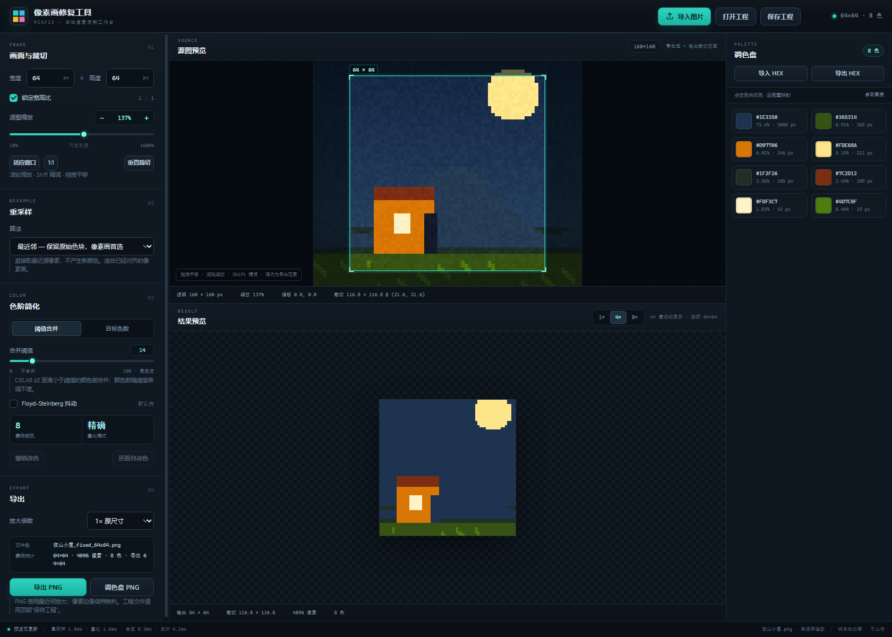

# 像素画修复工具 · PIXFIX

一个**纯前端、零外部依赖、无需联网**的像素画后期修复工具。面向扩散模型生成的“伪像素画”：尺寸与边缘不齐、颜色存在大量细微抖动、实际配色远超像素画所需的情况。



- 所有处理都在本地浏览器完成，不上传任何图片。
- 全中文界面；暗色三栏工作台：左侧参数、中间源图/结果预览、右侧调色盘。
- 双击 `index.html` 即可使用，也提供本地 HTTP 启动脚本。
- 不依赖 CDN、NPM 包、字体文件或任何网络资源；仅使用 Canvas 2D 与原生 ES module。

---

## 目录

- [快速开始](#快速开始)
- [界面分区](#界面分区)
- [六项功能操作](#六项功能操作)
- [调色盘联动](#调色盘联动)
- [快捷键](#快捷键)
- [工程文件格式](#工程文件格式)
- [算法说明](#算法说明)
- [测试与验收](#测试与验收)
- [已知限制](#已知限制)
- [开发说明](#开发说明)

---

## 快速开始

### 方式一：双击 index.html（日常使用）

直接双击 `E:\pixel-fixer\index.html`。

> **关于 file:// 的说明**
>
> 按 Chromium / Edge 的安全策略，`file://` 页面不能跨文件加载 ES module：
> 内联 `<script type="module">` 可以执行，但 `import './src/app.js'` 会被 CORS 拦截。
> 页面因此内置了协议检测：
>
> - `http://` / `https://`：加载原生 ES module 入口 `src/app.js`；
> - `file://`：自动改用 `src/standalone.js`。它由 `tools/build-standalone.js`
>   从同一套 `src/*.js` 源码生成，是经典脚本兼容包，不是另一套实现。
>
> 修改 `src/*.js` 后执行一次 `node tools/build-standalone.js` 刷新兼容包即可；
> 普通用户不需要运行构建。

### 方式二：serve.ps1（本地 HTTP，最稳妥）

在资源管理器里右键 `serve.ps1` →“使用 PowerShell 运行”，或打开 PowerShell：

```powershell
cd E:\pixel-fixer
powershell -ExecutionPolicy Bypass -File .\serve.ps1
```

脚本会在 `127.0.0.1:8123` 启动 `python -m http.server` 并自动打开浏览器。
可指定端口或只启动服务：

```powershell
.\serve.ps1 -Port 9000
.\serve.ps1 -NoOpen
```

### 方式三：直接使用 Python

```powershell
cd E:\pixel-fixer
python -m http.server 8123
```

然后访问 <http://127.0.0.1:8123/>。

### 测试

不需要安装任何依赖（需要 Node.js 18+）：

```powershell
node --test tests/*.test.js
# 或
npm test
```

---

## 界面分区

页面从上到下、从左到右分为五块：

1. **顶栏**：品牌、`导入图片` / `打开工程` / `保存工程` 三个主按钮，右侧状态灯与当前输出尺寸/颜色数。
2. **左侧参数栏**（可滚动）：
   - `01 画面与裁切`：输出宽高（8~512，默认 64×64）、锁定宽高比、源图缩放（对数滑块 / 百分比输入 / `−` `+` 微调 / 适应窗口 / 1:1 / 重置裁切）；
   - `02 重采样`：五种算法下拉框与说明；
   - `03 色阶简化`：相近色合并 / 指定色数两种模式、相近程度滑块、区域联动、Floyd–Steinberg 抖动开关、最终颜色数/颜色精度、撤销改色/还原自动色；
   - `04 导出`：放大倍数、文件名与统计、导出 PNG / 调色盘 PNG。
3. **中间源图预览**：显示原图与青色输出裁切框；框外压暗，四角有手柄；底部显示源图尺寸、缩放、偏移、裁切坐标。
4. **中间结果预览**：严格按输出尺寸（1×）生成，再以 1×/4×/8× 最近邻放大显示；透明区域透出棋盘格；底部显示输出尺寸、裁切、像素数、最终颜色数与当前像素位置/颜色。
5. **右侧调色盘**：`导入 HEX` / `导出 HEX`，`悬停色块时高亮像素` 开关，色块列表（色块、HEX、像素占比与像素数），点击任意色块即可改色；底部状态栏显示耗时、工程保存状态与“纯本地处理”提示。

页面还包含：拖拽导入遮罩、Toast 提示、粘贴导入、空状态引导。

---

## 六项功能操作

### 1. 导入图片与裁切

1. 点击顶栏 `导入图片`，或把图片拖到页面上，或按 `Ctrl+V` 粘贴剪贴板图片；
2. 也可以在源图预览的空白状态里点 `选择图片`；
3. 在源图预览中**按住左键拖动**平移画面，**滚轮**以鼠标位置为中心连续缩放（按住 `Shift` 精调）；也可以使用左侧“源图缩放”的对数滑块、百分比输入框与 `−` / `+` 按钮；
4. 青色框就是最终导出的裁切范围；框外会压暗，底部实时显示裁切坐标与尺寸；
5. 在左侧设置输出宽高（8~512，默认 64×64）。勾选“锁定宽高比”时改一边会联动另一边；
6. 点 `适应窗口` 让整张源图落入预览区；`1:1` 回到 100%；`重置裁切` 恢复 100% 缩放与居中。

### 2. 重采样

在 `02 重采样` 的下拉框中选择：

| 选项 | 适用场景 |
| --- | --- |
| 最近邻（默认） | 已经对齐的像素画，不产生新颜色 |
| 双线性 | 需要柔和过渡的照片式素材 |
| 双三次（Catmull-Rom） | 更平滑的边缘 |
| Lanczos3 | 缩小时保留更多细节，可能轻微振铃 |
| 区域平均 | 大幅缩小、抗锯齿最稳定 |

切换后结果预览、颜色数与调色盘会立即重建。像素画一般优先用“最近邻”，再用色阶简化清理杂色。

### 3. 色阶简化

1. 选择 `相近色合并`，拖动“相近程度”滑块（0~100）；
   - 相近程度 0 = 完全不合并，保留所有精确颜色；
   - 数值越大，允许合并的颜色差异越大，最终颜色越少；颜色数只会减少，不会随数值提高而反弹；
   - 只有整组颜色两两之间的差异都不超过设定值才会合并，不会因为中间色把远处颜色也带进来；
   - 左侧实时显示“最终颜色”数量，右侧调色盘同步更新。
2. `区域联动`（默认开启）把孤立的零散像素并入相邻主色，使同色区域更完整；只在相近色合并模式下生效，相近程度为 0 时不生效。关闭后立即回到未联动结果。
3. 或选择 `指定色数`，输入 2~256 的目标颜色数，工具会把画面归并为不超过 N 种颜色。
4. 需要平滑渐变时，可打开 `Floyd–Steinberg 抖动`（默认关闭）。抖动只改变像素到调色板的映射，不改变调色板本身。
5. 调色盘每个色块显示：颜色、`#RRGGBB`、占比和实际像素数；颜色很多时按块异步渲染，滚动即可查看。
6. “颜色精度”通常显示 `精确`；颜色超过 7000 种且相近程度不低于 3 时显示 `近似加速`，表示为了保持流畅做了轻微近似，相近程度 0~2 仍按原色精确计算。

### 4. 重新指定颜色

1. **点色块改色**：点击右侧任意色块，系统原生取色器打开；选择新颜色后，画布上所有属于该自动色的像素会立即重新映射为新颜色。
2. **重新映射**：内部维护 `recolorMap`（自动聚类颜色 → 新颜色）。改色、导入 HEX、撤销都会更新这张表，然后只重新合成输出（不重新量化），所以响应很快。
3. **撤销/重置**：
   - `撤销改色`（或 `Ctrl+Z`）最多回退 50 步；
   - `还原自动色` 清空全部手动改色。
4. **调色板导入/导出**：
   - `导出 HEX`：把当前最终颜色按顺序导出为每行一个 `#RRGGBB` 的 `.hex` 文件（自动去重、大写）；
   - `导入 HEX`：读取 `.hex` / `.txt`（每行一个 `#rgb` 或 `#rrggbb`，允许 `//`、`;` 注释和行尾注释），按自动调色板的频率顺序依次映射到前 N 个颜色；
   - 导出的文件可以直接再导入，得到等价调色板。

### 5. 导出

1. 在 `04 导出` 选择放大倍数：`1× 原尺寸` / `2×` / `4×` / `8×` / `16×`；
2. 面板会实时显示文件名、输出像素数、颜色数和实际导出尺寸；
3. 点 `导出 PNG`：使用 Canvas 的 `toBlob` 编码；放大采用最近邻，像素边缘保持锐利、颜色值完全不变；
4. 点 `调色盘 PNG`：导出色块网格图（色块会自动换行，颜色多时自动缩小）；
5. 文件名规则：
   - 1×：`<原名>_fixed_<宽>x<高>.png`
   - 放大：`<原名>_fixed_<宽>x<高>@4x.png`（示例）
   - 调色盘：`<原名>_palette_<颜色数>colors.png`
6. 输出超过约 2400 万像素时会先弹窗确认，避免浏览器内存不足。

### 6. 工程文件 `.pixfix.json`

1. 点顶栏 `保存工程`（或 `Ctrl+S`）下载工程文件；
2. 点 `打开工程`（或 `Ctrl+O`）、或直接把 `.pixfix.json` 拖进页面，即可完整恢复；
3. 保存内容：源图 dataURL（base64）、源图尺寸、裁切缩放/偏移、输出尺寸、重采样算法、相近程度/目标色数/抖动/区域联动、自动调色板、改色映射、最终调色板、结果预览倍数、锁定宽高比、导出倍数、调色盘联动开关、创建/更新时间；
4. 加载时按保存的参数重新解码、重采样、聚类，再应用 `recolorMap`；
5. 如果源图实际解码尺寸与记录不同，或自动调色板因算法版本变化而重建，会给出提示，但不会丢弃工程；
6. 工程体积超过 8MB 时会二次确认（主要是源图 base64）。

---

## 调色盘联动

调色盘与结果预览之间提供双向定位，用来确认某块颜色在画面中的位置，或某个像素属于哪个色块。

### 预览像素 → 调色盘高亮

1. 把鼠标移到「结果预览」上，底部会显示「当前像素：x, y · #RRGGBB」；透明像素显示“透明”；
2. 右侧调色盘会自动高亮对应的色块：描边加粗、轻微放大并带一层发光，同时滚动到可见区域；
3. 鼠标旁会出现简短提示：颜色值 · 该色占比 · 像素数；离开预览后全部取消；
4. 1× / 4× / 8× 三种显示倍数都按同一套坐标换算，画布滚动、内边距与高 DPI 屏幕不会导致指错像素；
5. 调色盘条目本身已经显示颜色值、占比和像素数，提示只是让这些信息在悬停时更容易读。

### 调色盘色块 → 预览像素高亮

1. 勾选（默认开启）右侧调色盘的 `悬停色块时高亮像素`；开关下方说明为“悬浮色块时，在预览中标出该颜色的像素。”；
2. 把鼠标悬浮在色块上，结果预览中属于该颜色的像素会被轻微提亮，边缘用 1px 青色线勾出；1× 显示时只提亮、不描边，避免细线盖住单个像素；移开后立即恢复；
3. 高亮只提亮，不覆盖原色；关闭开关只会停用这个方向，预览像素 → 调色盘的定位仍然可用；
4. 结果超过 256×256 像素时只使用预生成的掩码画布提亮，不再逐像素描边，避免大图悬停卡顿；
5. 鼠标移动按 `requestAnimationFrame` 合并；同一像素重复悬停不会重复换算或滚动；同一色块的高亮掩码只生成一次。

### 什么时候会重建

重采样算法、相近程度、目标色数、抖动、区域联动、改色、裁切范围或输出尺寸发生变化后，输出像素与调色盘索引的对应关系会重建，当前高亮立即失效并在下一次悬停时重新计算，不会停留在旧色块上。切换结果预览倍数时，反向高亮的掩码也会按新倍数重新生成。

### 工程文件

开关状态保存在工程文件的 `ui.hoverHighlight`（布尔值）。旧工程没有该字段时默认视为开启。

---

## 缩放控制

「画面与裁切」里的“源图缩放”同时提供鼠标、滑块、数值与按钮四种入口，范围固定为 **1%~6400%**，任何入口都会夹在这个区间内。

| 入口 | 行为 |
| --- | --- |
| 滚轮 | 以鼠标所在位置为锚点连续缩放；`factor = exp(-deltaY × 0.0015)`，不会一档一档跳变 |
| `Shift` + 滚轮 | 灵敏度 ×0.25，适合 1% 级别的精调 |
| 对数滑块 | 拖动连续变化；刻度中点是 10% 与 1600% 的几何平均（约 126%），低倍率区间更易控制 |
| 百分比输入框 | 输入 `137`、`137%`、`137.5 %` 均可，回车或失焦生效，越界自动夹住 |
| `−` / `+` 按钮 | 每次缩小 ÷1.02 / 放大 ×1.02；按住 `Shift` 改为 ÷1.005 / ×1.005 |
| `适应窗口` | 让整张源图落入预览画布并居中（受 10% 下限约束） |
| `1:1` | 回到 100%，保留当前裁切中心 |
| `重置裁切` | 回到 100% 并居中（偏移归零） |

缩放时保持鼠标下的源图坐标不动；当裁切框已经贴到源图边缘时，偏移会被 `constrainTransform` 限制，此时锚点会按边界规则轻微移动。滚轮与重绘都按 `requestAnimationFrame` 合并，同一帧内的多个滚轮事件只计算、绘制一次。

工程文件会把当前缩放写入 `ui.sourceZoom`（百分比）；加载时优先用它恢复。旧工程没有该字段时按 `transform.scale` 推导，因此不会丢失保存时的缩放。

---

## 快捷键

| 快捷键 | 功能 |
| --- | --- |
| `Ctrl+V` | 粘贴剪贴板图片 |
| `Ctrl+S` | 保存工程 |
| `Ctrl+O` | 打开工程 |
| `Ctrl+Z` | 撤销调色盘改色（焦点不在输入框时） |
| `+` | 放大 2%（焦点不在输入框时） |
| `-` | 缩小 2% |
| `0` | 回到 1:1（100%） |
| `f` | 适应窗口 |

---

## 工程文件格式

扩展名建议 `.pixfix.json`，内容是 UTF-8 JSON：

```json
{
  "version": 1,
  "createdAt": "2026-11-09T12:00:00.000Z",
  "updatedAt": "2026-11-09T12:10:00.000Z",
  "sourceImage": "data:image/png;base64,iVBORw0KGgo...",
  "sourceWidth": 1024,
  "sourceHeight": 768,
  "sourceName": "夜山小屋.png",
  "transform": {
    "scale": 1.75,
    "offsetX": -12.5,
    "offsetY": 8,
    "outputWidth": 64,
    "outputHeight": 64
  },
  "resample": "nearest",
  "colorMode": "threshold",
  "threshold": 14,
  "maxColors": 16,
  "dither": false,
  "palette": ["#1c314d", "#365314", "#d97706", "#ff4fd8"],
  "recolorMap": { "#1c314d": "#ff4fd8" },
  "manualPalette": ["#ff4fd8", "#365314", "#d97706"],
  "ui": { "resultZoom": 4, "lockAspect": true, "exportScale": 4, "sourceZoom": 137, "hoverHighlight": true }
}
```

| 字段 | 类型 | 说明 |
| --- | --- | --- |
| `version` | number | 当前固定为 `1`；加载其他版本会被拒绝 |
| `createdAt` | ISO 8601 | 首次导入/创建时间 |
| `updatedAt` | ISO 8601 | 最近保存时间 |
| `sourceImage` | string | 源图 dataURL（内嵌 base64） |
| `sourceWidth` / `sourceHeight` | number | 源图原始像素尺寸 |
| `sourceName` | string | 原始文件名（用于界面与导出命名） |
| `transform.scale` | number | 1%~6400%，即 0.01~64；1 = 像素 1:1 |
| `transform.offsetX/Y` | number | 裁切中心相对源图中心的偏移（源图像素） |
| `transform.outputWidth/Height` | number | 输出尺寸，8~512 |
| `resample` | string | `nearest` / `bilinear` / `bicubic` / `lanczos3` / `area` |
| `colorMode` | string | `threshold` / `target` |
| `threshold` | number | 相近程度 0~100（指定色数模式也会保存） |
| `maxColors` | number | 目标色数 1~256 |
| `dither` | boolean | 是否抖动 |
| `colorSpatial` | boolean | 是否启用区域联动；缺省为 `true` |
| `palette` | string[] | 自动聚类调色板（HEX，按频次排序），用于校验/记录 |
| `recolorMap` | object | 自动色 → 手动色 映射，键值均为 `#rrggbb` |
| `manualPalette` | string[] | 最终调色板（应用改色后） |
| `ui.resultZoom` | number | 结果预览倍数，1 / 4 / 8 |
| `ui.lockAspect` | boolean | 宽高比锁定状态 |
| `ui.exportScale` | number | 导出放大倍数，1 / 2 / 4 / 8 / 16 |
| `ui.sourceZoom` | number | 源图缩放百分比，10~1600；与 `transform.scale` 对应，加载时优先使用 |
| `ui.hoverHighlight` | boolean | 是否在悬浮色块时于结果预览中标出同色像素；缺省为 `true` |

加载时：

1. 严格校验版本、dataURL、尺寸与字段范围；
2. 用保存的源图与参数重新解码、重采样、聚类；
3. 用 `recolorMap` 重新应用手动改色；
4. 若源图实际尺寸与记录不同、或自动调色板因环境重建结果不同，会给出提示，但不会丢弃工程。

`palette` 与 `manualPalette` 主要作为记录和校验；真正决定画面的是源图 + 参数 + `recolorMap`。
聚类实现固定了排序与 k-means 随机种子，同一数据通常可完全复现。
旧版工程若没有 `ui.exportScale`，加载时会回退为 `1`。
旧版工程若没有 `ui.sourceZoom`，会按 `transform.scale × 100` 推导，因此旧文件的缩放仍能完整恢复。
旧版工程若没有 `ui.hoverHighlight`，加载时默认开启。
旧版工程若没有 `colorSpatial`，加载时默认开启区域联动。

---

## 算法说明

### 裁切与坐标模型

设源图宽高为 `sw, sh`，输出宽高为 `outW, outH`。`scale = 1` 表示像素 1:1：
裁切框在源图上正好取输出尺寸那么大；`scale` 越大裁切框越小（放大细节），
`scale` 越小裁切框越大（缩小取景）。

```
cropW = outW / scale
cropH = outH / scale
cropCenter = (sw/2 + offsetX, sh/2 + offsetY)
```

- `scale` 范围 0.01~64，界面显示为 1%~6400%；
- `offsetX/offsetY` 单位是源图像素，表示裁切中心相对源图中心的偏移；
- 偏移受约束：正常缩放时裁切框不会跑出源图；当裁切框比源图还大时，允许源图在框内滑动；
- 所有坐标都与预览画布尺寸无关，因此工程文件可在不同窗口大小下恢复。

### 重采样

统一使用“像素中心”坐标约定：

```
srcX = crop.x + (outX + 0.5) * crop.width / outW - 0.5
```

- **最近邻**：取 `round(srcX), round(srcY)`，透明度原样保留，不产生新颜色；
- **双线性 / 双三次 / Lanczos3**：卷积核在连续源坐标上采样；
  - 缩小时按缩放倍率扩大核半径做抗锯齿，支持半径最多 2×（为了预览流畅）；
  - 透明度按预乘 alpha 处理，避免透明边缘发黑；
- **区域平均**：按每个输出像素覆盖的源像素面积精确加权；裁剪区域超出源图时，超出的面积
  不参与颜色。

### 相近色合并

1. 统计结果图中非全透明像素的颜色及出现次数；
2. 转换到 CIELAB（D65），用 CIE76 色差衡量两种颜色的差异，滑块数值直接对应 0~100 的色差；
3. 把颜色组织成一棵固定的分层结构，每个分支记录“这组颜色里任意两色的最大差异”；
4. 从顶层向下检查：
   - 整组最大差异不超过设定值时，整组合并为一种颜色；
   - 超过时继续细分，直到满足条件或只剩一种颜色；
5. 结构只由颜色本身决定、与滑块无关，所以数值提高时只会发生更多合并，颜色数**单调不增**；
6. 合并后的代表色是组内颜色按像素数加权的平均值；单色簇保留精确原色；
7. 相近程度 0 直接返回精确颜色，不执行任何合并；
8. 小簇会精确比较所有颜色对；大簇用“2 × 最远距离”作为安全上界。上界可能略大于实际最大差异，因此偶尔会多分一组，但不会把超过设定值的颜色并进来。

这样既不会出现“A 与 B 相近、B 与 C 相近，就把 A、C 并在一起”的情况，也不需要在每次拖动滑块时重新计算整棵结构。

### 区域联动

像素画里同一种颜色通常连成片。区域联动在聚类完成后做 1~2 轮平滑：

- 只处理 8 邻域内没有任何同色的孤立像素；
- 邻域主色需占可见邻域的 60% 以上（角落至少 3 个邻居）；
- 当前颜色与邻域主色的差异不超过“相近程度”和 3 中较小的一个。3 接近人眼可察觉差异的下限，避免把有意保留的两种颜色抹平；
- 固定按行优先顺序扫描，每轮基于上一轮快照判断，结果可复现；
- 棋盘格、斜线和细线等交错图案的像素在斜向或沿线有同色邻居，不会被改动；成片区域内部也不会被改动；
- 相近程度为 0 时不生效；关闭开关立即回到未联动结果；
- 抖动开启时不参与区域联动，避免把刻意打散的像素又并回去。

### 目标色数（带权 k-means++）

- 颜色数不超过目标 N 时直接保留原色；
- 否则在 LAB 空间执行带权 k-means++：
  - 第一个中心取最高频颜色；
  - 其余中心按“频次 × 到已有中心距离²”的权重抽样；
  - 固定随机种子，同图结果稳定；
  - 最多 18 次迭代，空簇自动消失；
  - 输出颜色数保证 ≤ N。

### Floyd–Steinberg 抖动

- 用调色板 RGB 最近邻（加权 RGB 距离）计算每个像素的替代色；
- 误差按 7/16、3/16、5/16、1/16 扩散到右、左下、下、右下；
- 抖动只改变像素到调色板的映射，不改变调色板本身；改色映射仍在最后应用；
- 默认关闭，符合像素画通常不使用抖动的习惯。

### 性能策略

- 画布交互与结果重建通过 `requestAnimationFrame` 合并；
- 几何指纹（源图、裁切、输出尺寸、算法）命中时复用重采样结果与 LAB 颜色模型；
- 只改相近程度/目标色数/抖动/区域联动时，不重新采样；颜色分层结构按颜色模型缓存，拖动滑块时直接复用；
- 颜色超过 7000 种且相近程度不低于 3 时，先按每通道 32 级做近似聚合以保持流畅；相近程度 0~2 不启用近似；
- 只改调色盘时，不重新量化，只重新合成；
- 调色盘超过 1200 色时分块异步渲染（`requestIdleCallback`，回退 `setTimeout`）；
- 调色盘联动：`pointermove` 按 `requestAnimationFrame` 合并，同一像素重复悬停直接跳过；
  反向高亮为每个颜色预生成一张输出分辨率的掩码画布，悬停时只做一次 `drawImage`，大图不逐帧扫描；
- 未使用 Web Worker：`file://` 下 Worker 加载模块同样受限，当前实现用主线程 rAF + 分层缓存即可满足目标场景。

---

## 测试与验收

### 自动单元测试

```powershell
npm test
```

当前共 **109 个测试，全部通过**（Node v24）：

| 文件 | 覆盖内容 |
| --- | --- |
| `tests/color.test.js` | HEX 解析/格式化、LAB 往返、色差、调色板文本解析 |
| `tests/resample.test.js` | 五种算法、最近邻取点、区域平均、透明边界、非法参数 |
| `tests/quantize.test.js` | 相近色/远色不链式合并、链式反例、每簇最大色差 ≤ 阈值、超过 7000 色时阈值 1 精确、区域联动（散点、噪点、棋盘格、阈值 0）、0~100 单调性、目标色数 ≤ N、透明度、抖动、模型复用 |
| `tests/exporter.test.js` | 1/2/4/8/16× 放大逐像素不变、调色盘色块、文件名、PNG 编码可解压还原 |
| `tests/project.test.js` | 字段规范化、序列化往返一致、幂等、非法版本/JSON/尺寸、UI 字段回退、`ui.sourceZoom` 保存与旧工程兼容、`ui.hoverHighlight` 缺省/显式关闭、`colorSpatial` 缺省/显式关闭 |
| `tests/engine.test.js` | 裁切几何（横图/竖图/偏移/缩放）、偏移约束、改色、透明合成、完整链路 + 工程往返 |
| `tests/uistate.test.js` | 宽高比锁定、显示格式、导出信息、剪贴板文件名、滑块进度、缩放 clamp / 对数滑块 / 滚轮因子 / 微调 / 键盘映射 / 锚点不变式 / 适应窗口 |
| `tests/palette-link.test.js` | 预览坐标 → 输出像素（1×/4×/8×、CSS 尺寸不一致、DPR、越界）、颜色 → 调色盘索引、像素颜色读取、像素数与占比统计、位置/提示文案、大结果判定 |

### 浏览器端验收

使用 Edge Headless + CDP 实际跑通（2026-11，Edge 157）：

- 导入 128×128 像素画（含渐变天空、成片房屋/山体）与 160×160 噪点图，输出分别设为 128×128 / 200×200；
- 滚轮缩放、拖拽平移、裁切坐标同步；
- 缩放交互 33 项 CDP 断言全部通过：指数滚轮（含 Shift ×0.25）、同帧事件合并、百分比输入（回车/失焦/越界夹取）、`−`/`+` 按钮（含 Shift）、键盘 `+ - 0 f`、对数滑块、适应窗口 / 1:1 / 重置裁切；
- 锚点不变式：滚轮前后鼠标下的源图坐标完全一致（误差 < 1e-9）；
- 五种重采样切换；最近邻不产生新颜色，插值算法会产生过渡色；
- 相近程度 0 → 2854 色；1 → 2854 色（阈值 1 不再大量合并）；3 → 1725 色；10 → 435 色；30 → 51 色；颜色数单调不增；房屋、山体等远色始终独立；
- 区域联动：噪点图在相近程度 4 下关闭时 125 色，开启后 11 个孤立像素并入邻域，成片房屋与山体不变；开关往返后结果可复现；
- 近似加速：200×200 噪点图在相近程度 4 下触发，界面显示“近似加速”和“颜色较多，已启用近似加速，个别颜色可能略有偏差。”；
- 目标色数 8 → 8 色；抖动开关生效；
- 点色块改色 → 3392 个像素整体变粉；`Ctrl+Z` 撤销；还原自动色清空；
- HEX 导出/导入；1×/2×/4×/8×/16× 导出逐像素与 1× 一致；调色盘 PNG 导出；
- 工程保存/重新加载：相近程度、模式、区域联动、重采样、缩放/偏移、输出尺寸、改色映射、UI 状态（含 `ui.sourceZoom`）全部恢复；
- 调色盘联动：通过真实文件选择器导入图片，连续悬浮 3 个不同颜色像素，右侧高亮色块随之切换，底部显示坐标与 HEX，悬浮提示显示颜色/占比/像素数；
- 大量颜色（相近程度 0，数百色）下悬浮靠后颜色，调色盘自动滚动且高亮色块进入可见区域；
- 悬浮色块：目标颜色像素被提亮、其他颜色像素逐通道不变；关闭开关后反向高亮取消，而预览像素 → 色块仍可用；工程 `ui.hoverHighlight` 开/关往返一致；
- 修改相近程度后旧高亮立即失效，底部复位为“当前像素：—”；
- `file://` 直接打开（`src/standalone.js`）时调色盘联动同样生效；
- `file://` 直接打开（`src/standalone.js`）时新缩放控件与快捷键同样可用；
- 控制台错误：0。

`tools/cdp-smoke.mjs` 是一个可选的 Edge + CDP 冒烟脚本：先启动本地服务与
`msedge --remote-debugging-port=9223`，再执行 `node tools/cdp-smoke.mjs`。

---

## 已知限制

1. **超大源图**：源图像素会同时保存在 `Image`、dataURL 和 `ImageData` 中；上万像素的图可能消耗数百 MB 内存，浏览器可能卡顿或崩溃。
2. **超大导出**：512×512 输出选择 16× 时画布为 8192×8192（约 6700 万像素），编码阶段需要大量内存；界面会二次确认，但仍可能失败。
3. **file:// 剪贴板差异**：不同浏览器/安全策略下 `Ctrl+V` 的剪贴板权限不同；若粘贴无反应，改用文件选择或通过 `serve.ps1` 访问。`file://` 不能跨文件加载 ES module，已用生成的 `src/standalone.js` 兼容包解决。
4. **透明度处理**：调色板忽略 alpha，只对非全透明像素聚类；合成时保留每个像素原本的 alpha。因此半透明边缘不会成为独立颜色，占比按“可见像素”计算。
5. **区域联动只处理孤立像素**：两像素以上的小色块、棋盘格和交错图案不会被并入邻域；相近程度为 0 时不生效。
6. **相近程度 0 颜色很多**：高噪声照片在相近程度 0 下可能产生几千种颜色，调色盘列表需要滚动；这是“不合并”的预期行为。
7. **极端缩小**：双线性/双三次/Lanczos3 的核支持半径做了 2× 上限；极端缩小建议选区域平均。
8. **近似加速**：超过 7000 种精确颜色且相近程度不低于 3 时，按每通道 32 级近似以保持交互流畅；结果是近似值，界面会显示“近似加速”。相近程度 0~2 不受影响。
9. **撤销范围**：按需求只实现调色盘改色的撤销；裁切、重采样、相近程度修改不进入撤销历史。
10. **工程体积**：工程内嵌原始图片 base64，通常比图片本身大约 33%；没有做压缩。
11. **HEX 导入语义**：按自动调色板的频率顺序“按序号”映射，而不是按最近色映射；导出的文件再导入可得到等价结果。
12. **原生取色器外观**：调用系统 `<input type="color">`，不同操作系统的取色器 UI 不一致。
13. **浏览器要求**：需要支持 Canvas 2D、ES2020、`requestIdleCallback`（无则回退）、`ImageData`、`FileReader` 的现代浏览器；推荐最新 Edge / Chrome / Firefox。
14. **缩放边界与贴边**：缩放固定夹在 1%~6400%；超大源图在 1% 下仍可能超出预览窗口，“适应窗口”也无法继续缩小，此时可拖拽平移查看。以鼠标为锚点缩放时，若裁切框已贴到源图边缘，偏移约束会让锚点按边界规则轻微移动。
15. **联动依赖指针移动**：预览像素定位由 `pointermove` 驱动；触摸屏需要按住并移动才会更新，移出画布后取消。滚动结果预览时会主动取消当前定位，下一次移动重新计算。
16. **大图反向高亮不描边**：结果超过 256×256 时只叠加半透明掩码提亮，不再逐像素画 1px 边界，以保证悬停流畅。
17. **分块渲染的调色盘**：颜色极多（超过 1200 色）时色块分块异步生成；若目标色块尚未渲染，悬停像素仍会显示底部信息与跟随提示，但不会自动滚动到不存在的卡片。稍候或滚动后即恢复正常。
18. **改色合并后的色块**：两个自动色被改成同一个 HEX 时，调色盘中会出现两个同色色块；像素定位按量化索引选择对应色块，而不是按颜色猜测，因此仍能高亮“真正属于”的那一个。

---

## 开发说明

### 目录结构

```
E:\pixel-fixer
├─ index.html                  页面骨架 + http/file 双启动
├─ styles.css                  暗色三栏界面
├─ serve.ps1                   本地 HTTP 启动脚本（默认 8123）
├─ package.json                无依赖；提供 test / build:standalone 脚本
├─ README.md
├─ docs/
│  └─ screenshot.png           界面截图
├─ src/
│  ├─ app.js                   UI、状态、画布、导入导出、交互
│  ├─ color.js                 sRGB/LAB、HEX 解析与格式化
│  ├─ resample.js              五种重采样算法（纯逻辑）
│  ├─ quantize.js              LAB 颜色聚类、区域联动、k-means++、抖动（纯逻辑）
│  ├─ engine.js                裁切几何、调色板复写、RGBA 合成（纯逻辑）
│  ├─ uistate.js               宽高比、显示格式、导出信息、缩放数学（纯逻辑）
│  ├─ palette-link.js          预览坐标 → 输出像素、颜色 → 调色盘索引、占比与文案（纯逻辑）
│  ├─ exporter.js              放大、调色盘色块图、文件名、无损 PNG 编码
│  ├─ project.js               .pixfix.json 创建/校验/序列化
│  └─ standalone.js            自动生成：file:// 经典脚本兼容包，请勿手改
├─ tests/
│  ├─ color.test.js
│  ├─ resample.test.js
│  ├─ quantize.test.js
│  ├─ exporter.test.js
│  ├─ engine.test.js
│  ├─ project.test.js
│  ├─ uistate.test.js
│  └─ palette-link.test.js
└─ tools/
   ├─ build-standalone.js      从 src/*.js 生成 standalone.js
   └─ cdp-smoke.mjs           可选的 Edge + CDP 冒烟脚本
```

### 开发命令

```powershell
# 单元测试
npm test

# 修改 src/*.js 后，刷新 file:// 兼容包
npm run build:standalone

# 启动本地服务
npm run serve
# 等价于
python -m http.server 8123
```

`src/standalone.js` 内嵌了一个极小的 CommonJS 风格加载器，只是把 ES module 转换成
经典脚本，不引入第三方打包器。它是生成产物；以原生 ES module 源码为唯一事实来源。
